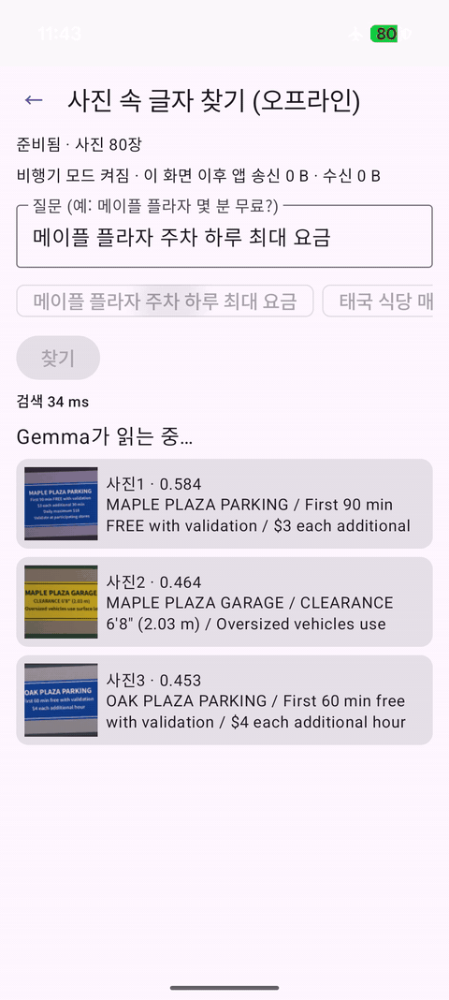

# Find the text in your phone's photos — offline, with Gemma on Android

Ask your phone *"how many minutes of free parking at Maple Plaza with validation?"* and it finds the parking sign you
photographed last month, reads the answer and shows the photo it came from. It does this **with no internet
connection, without uploading a single photo, at zero cost per question.**

<p align="center"></p>

<p align="center"><sub>Pixel 11 Pro XL in airplane mode, real time (21.6 s, not sped up). The three questions are the app's
example chips, picked because they gave the same answer in every run: a Korean question answered from an English sign
(<b>$18</b>), a negative answer (<b>not refundable</b>), and a question with no answer in the photos (<b>refused</b>).
Notification icons in the status bar are blanked.</sub></p>

**In one line:** on a Pixel 11 Pro XL in airplane mode, 80 photos and screenshots → **47–49 of 55 questions answered
correctly with the right photo cited, 5 of 5 "it's not in your photos" questions refused, ~4 s per question,
0 bytes sent.** Gemini Flash in the cloud does better on accuracy (**55 of 55**) — the numbers for both are below.

This repository started as a release of short-sequence EmbeddingGemma files for LiteRT. Those files are the search
part of this demo; their download and benchmarks are [further down](#the-embeddinggemma-files).

---

## The question this answers

"Why run this on the phone? Just send it to Gemini Flash."

That is a fair question, and part of the answer is *you should*, when accuracy is all that matters. We ran the same
photos and questions through both. The phone does not win on accuracy. It wins on the other things: the photos never
leave the phone, it works with no signal, and every question is free.

## Results at a glance

Same 80 photos, same 60 questions with answers fixed before any model ran. On-device numbers are two runs; cloud
numbers are one run each (2026-10-15).

| | **On the phone** | Cloud A: photos → Flash | Cloud B: phone's OCR text → Flash | Cloud C: photos → Flash-Lite |
|---|---|---|---|---|
| Models | ML Kit OCR + EmbeddingGemma (this repo) + Gemma 4 E2B | gemini-3.8-flash | gemini-3.8-flash | gemini-3.5-flash-lite |
| Correct answer + right photo cited (of 55) | 49 · 47 | **55** | 54 | 53 |
| "Not in your photos" refused (of 5) | 5 · 5 | 5 | 5 | 5 |
| Time per question (median) | **3.7–4.1 s** | 14.0 s | 3.9 s | 10.4 s |
| Data sent | **0 bytes** (airplane mode) | 7.24 MB of photos once + ~15 KB per question | ~20 KB of photo text per question | same as A |
| Cost for 60 questions | **$0** | ~$4.02 | ~$0.36 | ~$1.58 |
| Works offline | **yes** | no | no | no |

Cost uses Google's published paid-tier prices on the run date and the token counts the API returned
(A and C send all 80 photos, ~87,500 input tokens, with every question). This is **without context caching**, which
was not measured: caching would lower the cost of re-sending the same photos, but the photos still have to be uploaded
and kept on the server for the cache's lifetime.

### Where the cloud wins

- **Accuracy.** Flash answered all 55 questions correctly. The phone got 47–49. The gap (6–8 questions) is larger than
  the phone's run-to-run variation (2–3 questions), so it is real.
- **It doesn't fall into the traps the phone did.** Negative answers ("not refundable"), shops named by type or in
  another language ("the pho place", "Daon Tea Room" for a sign that says 다온 찻집), look-alike shops — Flash handled
  all of them. The phone needed five prompt and code iterations to get partway there ([below](#how-it-fails)).
- **Reading the photo itself.** Flash read `MARU_GUEST` correctly from the image; the phone's OCR dropped the
  underscore, and so did Flash when it was only given the phone's OCR text (arm B).

### Where the phone wins

- **Nothing is uploaded.** Cloud A/C needs the whole photo library on Google's servers (uploaded files also expire after
  48 hours). Even the text-only middle road (B) sends what is *in* the photos: receipts, booking numbers, Wi‑Fi passwords.
- **No signal needed.** Every number in the phone column was measured in airplane mode, with the app's own traffic
  counter at 0 bytes sent and received.
- **No cost per question.** The photo-based cloud arms pay for every photo on every question; with more photos the cost
  grows with them.
- **Not slower.** ~4 s per question, about the same as sending text to Flash and faster than sending photos.

## What it does, step by step

```text
index (once per photo)
  photo ──► ML Kit text recognition ──► rows rebuilt by geometry ──► EmbeddingGemma seq64, 64-token chunks
             (bundled Korean model,       (keeps "Kimchi Jjigae $16.99"     (this repo, LiteRT CompiledModel,
              reads Latin too)              on one line)                      CPU 4 threads)

ask
  question ──► same embedder ──► best chunk per photo ──► top 3 photos ──► Gemma 4 E2B (GPU, LiteRT-LM)
                                                                             1. "is the information there?"  있음/없음
                                                                             2. answer + which photo
                                                                          ──► code check: does the cited photo
                                                                              belong to the shop you asked about?
```

| Step | Phone time (median) |
|---|---|
| Read text from one photo (ML Kit) | 116–123 ms |
| Embed one photo (1.5 chunks on average) | 32–35 ms |
| Index all 80 photos | ~15 s |
| Embed the question | 41–49 ms |
| Compare against 80 photos | ~1 ms |
| Gemma: "is it there?" | 0.8–1.0 s |
| Gemma: answer | 2.0–2.6 s |

Battery, cable unplugged, airplane mode, screen on, whole phone: indexing 80 photos ≈ 20 mWh, one question ≈ 3.6 mWh
(≈ 0.9 mAh), measured with the first prompt version. Both models loaded together: 2.2–2.4 GB of memory.

## How it fails

Every failure below happened on the phone, with the exact question and photo. We kept each version runnable
(`v1`–`v5` chips on the demo screen) so they can be reproduced.

### 0. OCR breaks names from prices

ML Kit returns a menu's dish names and its prices as separate blocks. In its raw text "김치찌개" and "$16.99" end up
dozens of lines apart, so nothing downstream can tell which price belongs to which dish.
**Fix:** rebuild rows from the line boxes, using one skew angle per photo (the median angle of the long lines). A
per-line angle was tried first and attached a receipt's *Tax* to the *Tip* amount — a wrong pair is worse than none.
**Result:** multi-word lines kept intact 231 → 511 of 572; all 12 receipts pair item ↔ price correctly.

### 1. Negative answers read as "no evidence" (v1 → v2)

The model was first asked "can any photo answer this? yes/no". It answered **the user's** yes/no question instead.

| Question | Top photo (correct) | Gate said |
|---|---|---|
| Can I bring my own wine to Blue Lantern and what does it cost? | Corkage fee $20 per bottle | no |
| Is my truck too tall for the Maple Plaza garage? | CLEARANCE 6'8" (2.03 m) | no |
| Can I take my dog into Daon Tea Room? | 반려동물은 테라스석만 가능합니다 / 실내 동반 불가 | no |

**Fix (v2):** the gate answers `있음/없음` ("present/absent") instead of yes/no, and the prompt says outright that
"not allowed", "No …", "closed" are answers too. **Result:** correct 42 → 46/45; wrongly refused 6 → 4.

### 2. Shops called by type or in another language (v2 → v3)

The rule "skip photos whose shop name differs from the question" also blocked questions that name no shop, or name it
in another language: *"the pho place"*, *"태국 식당"* (Thai restaurant), *Daon* ↔ *다온*.
**Fix (v3):** split the rule — a named shop must match (English and Korean spellings of the same name count), a shop
described by type matches by type. The examples in the prompt use words that appear nowhere in the test set.
**Result:** 46/46; two of the four fixed, one earlier fix regressed (the truck question), and the gate started breaking
its one-word format.

### 3. Answering about a shop that isn't there (v3 → v4 → v5)

*"Moonrise Donuts happy hour"* — there are Moonrise Donuts photos (a menu, a preorder screen), but none mentions a happy hour. The model cited the Corner Slice happy-hour sign, and in one
run wrote (in Korean) **"Moonrise Donuts' happy hour is 3–5 PM"**, putting the right shop's name on the wrong shop's facts.
- **v4: ask the model again** ("is this photo from the shop in the question? same/different"). It said "same" **108 times
  out of 108**, including this case. No effect, +0.9 s per question.
- **v5: check in code.** Take each photo's first content line as its shop name; drop a citation only when the question
  names a known shop, the cited photo doesn't contain that name, and the photo belongs to another known shop.
  A dry run on eight earlier runs caught only this case and dropped no correct answer.
  **Result:** "not in your photos" refused **5/5 in both runs** (every earlier version: 4/5), check time < 1 ms.

### 4. What is still wrong

- A question that names a shop by type sometimes still gets refused ("is *the pho place* open on Thanksgiving?").
- The model sometimes cites the right photo and answers a different field on it (break time 15:00–17:00 → "last
  order 14:30").
- **Greedy decoding is not deterministic on the phone's GPU.** With temperature 0 and top-k 1, only 43–48 of 60 raw
  answers were identical between two runs, and once a stray Cyrillic word appeared in a Korean answer. Our guess is that
  the GPU's floating-point reductions don't always add in the same order, so near-tied tokens flip — not verified.
  Scores moved by up to 3 questions between identical runs, which is why every on-device number above is from two runs.
- The v5 rules (skip the status bar, skip an app screen's title line) were chosen after looking at these photos.

### Two measurement traps worth knowing

- **How the app is started changes CPU speed 6×.** Launched with `adb shell am start` and run immediately, the app sat
  in the `/foreground` cpuset; started by a tap, in `/top-app`. OCR 771 ms vs 116 ms per photo, question embedding
  122–137 ms vs 41–49 ms. GPU work barely changed. All numbers above are tap-started.
- **The USB cable hides battery use**: the charger carries the load, so battery level and current say nothing.
  Battery was measured unplugged only.

## Run it yourself

**The data is synthetic.** 80 images rendered from made-up shops (menus as screenshots and chalkboard photos, parking
signs, receipts, notices, booking screens, and distractors with look-alike names), with perspective, rotation, lighting,
noise and blur. The 60 questions (lookup, paraphrase, cross-language, numbers, items deep in long menus, and five with
no answer) were fixed in git before any model ran. Everything is in [`demo/photo_text_search/`](demo/photo_text_search/):
the images and answers in `data/`, every run in `results/`.

The generator uses fixed seeds, but two of its fonts (Consolas, Georgia) ship with Windows, so on another system the
images will not come out identical — use the committed images to reproduce the numbers. To render them yourself, point
`FONT_DIR` at a folder with `NotoSansKR-VF.ttf`, `consola(b).ttf` and `georgia(b).ttf`:

```bash
python demo/photo_text_search/gen_dataset.py --sheets
```

```bash
python demo/photo_text_search/validate_dataset.py
```

### On the phone

The Android app in [`android/`](android/) is the demo screen and nothing else. Its manifest removes the INTERNET
permission that ML Kit and Play services would otherwise merge in, so the app cannot send data at all.

1. Models and tokenizer (none are redistributed here; all are subject to the [Gemma Terms of Use](https://ai.google.dev/gemma/terms)):
   - `embeddinggemma-300m_seq64_q8.tflite` from this repo's [Releases](#download).
   - `gemma-4-E2B-it.litertlm` (2.58 GB) from
     [litert-community/gemma-4-E2B-it-litert-lm](https://huggingface.co/litert-community/gemma-4-E2B-it-litert-lm).
   - `gemma_tokenizer.bin`, built from the EmbeddingGemma tokenizer:

     ```bash
     python scripts/build_tokenizer_blob.py --out gemma_tokenizer.bin
     ```

2. Push models and photos (the app reads `/data/local/tmp/`):

   ```bash
   adb push embeddinggemma-300m_seq64_q8.tflite gemma-4-E2B-it.litertlm gemma_tokenizer.bin /data/local/tmp/
   ```

   ```bash
   adb push demo/photo_text_search/data/images /data/local/tmp/demo_images
   ```

   ```bash
   ls demo/photo_text_search/data/images/*.jpg | sed 's#.*/#/data/local/tmp/demo_images/#' > list.txt && adb push list.txt /data/local/tmp/demo_images/
   ```

   ```bash
   adb push demo/photo_text_search/data/questions.json /data/local/tmp/demo_images/
   ```

3. Build and install (JDK 17+, Android SDK 36), then **open the app from the launcher**:

   ```bash
   cd android && ./gradlew installDebug
   ```

   The first start reads all 80 photos (~15 s) and loads Gemma; the index is cached after that. Tap one of the example
   questions or type your own. Start the app with `--ez dev true` to show the prompt-version chips (v1–v5) and the
   "60 questions" button, which writes `files/photo_demo/run_manual_v5.json`; score it with
   `python demo/photo_text_search/score_device.py <file>`.

### On a PC and in the cloud

```bash
python demo/photo_text_search/pc_baseline.py
```

Cloud comparison — needs your own Gemini API key in `GEMINI_API_KEY`, sends only the synthetic data:

```bash
python demo/photo_text_search/cloud_compare.py run A
```

## The EmbeddingGemma files

LiteRT (`.tflite`) conversions of [google/embeddinggemma-300m](https://huggingface.co/google/embeddinggemma-300m) with
**fixed input lengths of 64 and 256 tokens**, dynamic int8, ~314 MB each. Mean cosine to the original PyTorch model
0.9985 (minimum 0.9934 over 20,836 public-benchmark texts).

> **These are modified files, not Google's originals.** They are Model Derivatives of `google/embeddinggemma-300m`,
> converted with [litert-torch](https://github.com/google-ai-edge/litert-torch). No weights were retrained.

### License and use restrictions

Gemma is provided under and subject to the **Gemma Terms of Use** found at
[ai.google.dev/gemma/terms](https://ai.google.dev/gemma/terms). By downloading or using the model files you agree
to those terms. The required notice is in [`NOTICE`](NOTICE).

Use of the model files is subject to the use restrictions in Section 3.2 of the Gemma Terms of Use, including the
[Gemma Prohibited Use Policy](https://ai.google.dev/gemma/prohibited_use_policy). These restrictions apply to you
and to anyone you redistribute the files (or further derivatives) to. If you redistribute them, you must pass
these restrictions on and include the Gemma Terms of Use and the `NOTICE` file.

This repository's code and documentation are licensed under the [Apache License 2.0](LICENSE). That license does
not apply to the model files, which are governed by the Gemma Terms of Use.


### Download

The model files are **not stored in git**. Download them from the
[GitHub Releases](https://github.com/kakasolg/embeddinggemma-litert-short-seq/releases) page.

| File | Input length | Size (bytes) | SHA256 | Use for |
|---|---|---|---|---|
| `embeddinggemma-300m_seq64_q8.tflite` | 64 tokens | 314,071,856 | `289ec1bcd3b3122cf91bfacd2eba98980a769d31665b80c8544434217660964e` | queries, sentences, short notes |
| `embeddinggemma-300m_seq256_q8.tflite` | 256 tokens | 314,497,248 | `eadc04a177b045c354185af18a301d08477382d7c43e9d9b8db3e0319ab7c729` | longer passages |

```bash
curl -LO https://github.com/kakasolg/embeddinggemma-litert-short-seq/releases/download/v1.0.0/embeddinggemma-300m_seq64_q8.tflite
```

```bash
curl -LO https://github.com/kakasolg/embeddinggemma-litert-short-seq/releases/download/v1.0.0/embeddinggemma-300m_seq256_q8.tflite
```

Or download both with the GitHub CLI:

```bash
gh release download v1.0.0 --repo kakasolg/embeddinggemma-litert-short-seq --pattern "*.tflite" --pattern SHA256SUMS
```

Verify the files:

```bash
sha256sum -c SHA256SUMS
```

Both files come from the same checkpoint with the same recipe. For inputs that fit in 64 tokens they return
**identical** vectors (checked on 6,899 benchmark texts), so you can mix them in one index. For example, use seq64
for queries and seq256 for documents. Do **not** mix them with vectors from other conversions of EmbeddingGemma.
Those are not interchangeable (cosine around 0.96 against these files).


### Usage

**Signature** (`serving_default`):

| Tensor | Shape | Type | Content |
|---|---|---|---|
| `args_0` | `[1, L]` | int64 | token IDs, zero-padded |
| `args_1` | `[1, L]` | int64 | attention mask (1 for real tokens, 0 for padding) |
| `output_0` | `[1, 768]` | float32 | sentence embedding, already pooled, projected and L2-normalized |

The input names carry no meaning. Bind by position: the first input is the token IDs and the second is the mask.

Tokenize with the original tokenizer (`google/embeddinggemma-300m`, with BOS/EOS) and use EmbeddingGemma's
task prompts:

| Task | Prefix |
|---|---|
| Search query | `task: search result \| query: ` |
| Document | `title: {title or "none"} \| text: ` |
| Sentence similarity | `task: sentence similarity \| query: ` |

```python
import numpy as np
from ai_edge_litert.interpreter import Interpreter
from transformers import AutoTokenizer

tok = AutoTokenizer.from_pretrained("google/embeddinggemma-300m")
it = Interpreter(model_path="embeddinggemma-300m_seq64_q8.tflite", num_threads=4)
it.allocate_tensors()
ids_in, mask_in = it.get_input_details()
out = it.get_output_details()[0]
L = ids_in["shape"][-1]

def embed(text: str) -> np.ndarray:
    ids = tok(text)["input_ids"]
    if len(ids) > L:
        print(f"warning: {len(ids)} tokens, truncated to {L}")  # see "Truncation" below
    ids = ids[:L]
    x = np.zeros((1, L), np.int64); x[0, :len(ids)] = ids
    m = np.zeros((1, L), np.int64); m[0, :len(ids)] = 1
    it.set_tensor(ids_in["index"], x)
    it.set_tensor(mask_in["index"], m)
    it.invoke()
    return it.get_tensor(out["index"])[0]

q = embed("task: search result | query: What is Tony Bennett's middle name?")
d = embed("title: none | text: Anthony Dominick Benedetto, known professionally as Tony Bennett ...")
print(float(q @ d))
```


**Android: use `CompiledModel`, not `Interpreter`.** With LiteRT 2.1.5 the classic `Interpreter` ignores the thread
count for XNNPACK and runs on one core. `CompiledModel` with `CpuOptions(4 threads)` gives bit-identical vectors and was
1.3–2.8× faster on a Pixel 11 Pro XL and a Galaxy Z Fold4 (seq64: 20–25 ms vs 57 ms on the Pixel). The GPU path does not
compile for these files (int64 inputs).

### ⚠️ Truncation: longer inputs are cut silently

The input shape is fixed. Text longer than L tokens (counting the task prefix and BOS) keeps only its
**first L tokens**. The rest, including EOS, is dropped. **No error is raised, and the vector looks normal.**
Count tokens before embedding and flag truncation yourself. The Android wrapper used for the measurements exposes
this as a `lastInputWasTruncated` flag.

Rough sizes (Gemma tokenizer, prompt included):
- A short Korean or English sentence is 20–25 tokens.
- A Korean Wikipedia paragraph has a median of 166 tokens.
- A scientific abstract has a median of 288 tokens.
- **64 tokens is about 2–3 short Korean sentences, or about 40 English words.**

Effect on long-document retrieval (nDCG@10 with the original model, so this measures truncation, not conversion):

| How documents are embedded | Ko-StrategyQA | SciFact |
|---|---|---|
| Full length (up to 2048 tokens) | 0.8068 | 0.7921 |
| First 256 tokens | 0.8056 | 0.7724 |
| **First 64 tokens (seq64, plain truncation)** | **0.7713** | **0.6795** |
| **64-token chunks, document score = best chunk** | **0.7953** | **0.7635** |

Short-text tasks lose nothing at 64 tokens: KorSTS and STSBenchmark scores are the same at 64, 256 and full length.

#### Recommended use

- **seq64:** queries, single sentences, short notes, titles. At this length it matches the original model and is
  the fastest option.
- **Long documents:** do not feed them to seq64 as-is (SciFact drops from 0.792 to 0.680). Instead, either:
  - split them into 64-token chunks (repeat the `title: … | text: ` prefix on each chunk) and score each document
    by its best chunk. This recovers 0.680 → 0.764 on SciFact and 0.771 → 0.795 on Ko-StrategyQA, at the cost of
    about 5–6 embeddings per document of that length; or
  - embed documents with **seq256** and queries with **seq64**. The vectors are compatible (see [Download](#download)).

### Benchmarks

Full tables, methodology and caveats: [`docs/BENCHMARKS.md`](docs/BENCHMARKS.md). Raw results are in
[`results/`](results/).

#### Quality on public benchmarks (PC, same token IDs for every model)

Scores use the MTEB task definitions (2.24.14 loaders): Spearman for STS and nDCG@10 for retrieval. They use the
prompts above and the stated truncation. They are for comparison within this table, not leaderboard submissions.

| Model | KorSTS | STSBenchmark | Ko-StrategyQA | SciFact |
|---|---|---|---|---|
| Original PyTorch, full length | 0.8091 | 0.8818 | 0.8068 | 0.7921 |
| Original PyTorch, first 256 tokens | 0.8091 | 0.8818 | 0.8056 | 0.7724 |
| **seq256 q8 (this repo)** | 0.8086 | 0.8817 | 0.8066 | 0.7758 |
| Original PyTorch, first 64 tokens | 0.8091 | 0.8818 | 0.7713 | 0.6795 |
| **seq64 q8 (this repo)** | 0.8086 | 0.8817 | 0.7669 | 0.6791 |

Differences from the original at the same length (paired bootstrap, 95% interval):
- STS: within ±0.001 on both tasks for both files.
- Retrieval: seq256 +0.001 (Ko-StrategyQA) / +0.003 (SciFact); seq64 −0.004 / −0.000.

Mean cosine to the original is 0.9985 for both files (minimum 0.9934, 1st percentile 0.9976).

For reference, the existing `litert-community/embeddinggemma-300m` seq256 file (179 MB, mixed precision) scores
0.8005 / 0.8806 / 0.7994 / 0.7597 on the same setup, with mean cosine 0.964 to the original. It is smaller and
supports longer inputs. The files here trade size for closeness to the original and short fixed lengths.

#### On-device (Pixel 11 Pro XL, Tensor G6)

The sample is 300 texts drawn with a fixed seed (20261014) from the four tasks above: 100 STS pairs, 50 queries
and 50 documents. Setup: CPU, LiteRT `Interpreter` (which on LiteRT 2.1.5 runs XNNPACK on one core regardless of the thread setting —
see "Android: use CompiledModel" above), phone connected over USB. The first 3 items of each
run are excluded as warm-up.

| File | Cosine to original (mean / min) | First run, ms per text (p95) | Later runs, ms per text |
|---|---|---|---|
| seq64 q8 | 0.9986 / 0.9971 | **29.8 (30.6)** | 32.6 – 71.1 |
| seq256 q8 | 0.9986 / 0.9971 | 147.8 (151.9) | 162.8 – 243.5 |

Latency depends on the fixed length, not on the text, because every input runs all L positions.

The 14 runs were back to back with no cooldown. Under that sustained load the phone lowered its big-core frequency
cap from 4.1 GHz to 1.8–2.8 GHz, and both files slowed down, while the reported thermal status stayed at 0 for most
of it. seq64 remained 3–4× faster than seq256 (36.8 vs 234.9 ms). If you embed many texts in one go, plan for the
"later runs" column.

### Conversion

```bash
pip install -r requirements-convert.txt
```

```bash
CK=<local snapshot of google/embeddinggemma-300m>
for L in 64 256; do
  python -m litert_torch.generative.examples.embedding_gemma.convert_to_tflite \
    --checkpoint_path=$CK --output_path=out --prefill_seq_lens=$L \
    --quantize=dynamic_int8 --output_name_prefix=embeddinggemma-300m_seq$L
done
```

The converter writes `embeddinggemma-300m_seq{64,256}_q8.tflite`. The converter's int4 options
(`dynamic_int4_block32/128`) give 161–175 MB files. They were evaluated and not released: quality was lower on all
four tasks (−0.005 to −0.023), and they ran slower than int8 on the phone (see `docs/BENCHMARKS.md`).

### Reproducing the benchmarks

```bash
pip install -r requirements-bench.txt
```

```bash
python scripts/eval_public_bench.py embed pt:64 pt:256 pt:full embeddinggemma-300m_seq64_q8.tflite embeddinggemma-300m_seq256_q8.tflite
```

```bash
python scripts/eval_public_bench.py score
```

```bash
python scripts/eval_public_bench.py chunk 64
```

The device steps are described in `docs/BENCHMARKS.md`. The datasets are downloaded through MTEB and are not
redistributed here; only scores and row numbers are stored in `results/`.

In the demo, plain truncation to 64 tokens finds the right photo first for 0.782 of the questions; prefix-preserving
64-token chunks with best-chunk scoring for 0.873 (full length: 0.909); for items deep in long menus, 3/8 → 5/8 (7/8).

## Repository layout

```
README.md                    this file
LICENSE                      Apache-2.0, for the code and documentation (not the model files)
NOTICE                       Gemma notice (required for redistribution)
SHA256SUMS                   checksums of the release assets
demo/photo_text_search/      synthetic dataset, questions, scoring and cloud-comparison scripts, all run results
android/                     the on-device demo app (Kotlin, Compose)
scripts/                     EmbeddingGemma benchmark scripts and the tokenizer blob builder
docs/BENCHMARKS.md           full EmbeddingGemma results and methodology
results/                     raw EmbeddingGemma benchmark results (JSON)
requirements-*.txt           pinned Python environments
```

## Limitations

- Synthetic data, 80 photos, one Android phone (Pixel 11 Pro XL) for the end-to-end numbers.
- Cloud arms were run once each; on-device twice. Differences of 2–3 questions are within run-to-run variation.
- The phone's accuracy is below Flash. The demo's claim is privacy, offline use and cost — not "smarter than the cloud".
- 2.6 GB of models on the phone (Gemma 4 E2B 2.58 GB + EmbeddingGemma 314 MB).
- The EmbeddingGemma files have a fixed length: inputs over 64 / 256 tokens are truncated silently (see above). Each is
  ~314 MB, mostly the 262,144 × 768 vocabulary table. Benchmarks cover Korean and English only; Matryoshka output
  truncation (512/256/128) was not evaluated. Their GPU path does not compile; NPU delegates and iOS were not tested.

## Acknowledgements

EmbeddingGemma and Gemma are developed by Google DeepMind. Text recognition uses ML Kit. Conversion uses litert-torch;
the language model runs on LiteRT-LM.
